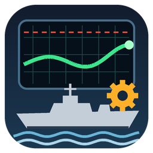
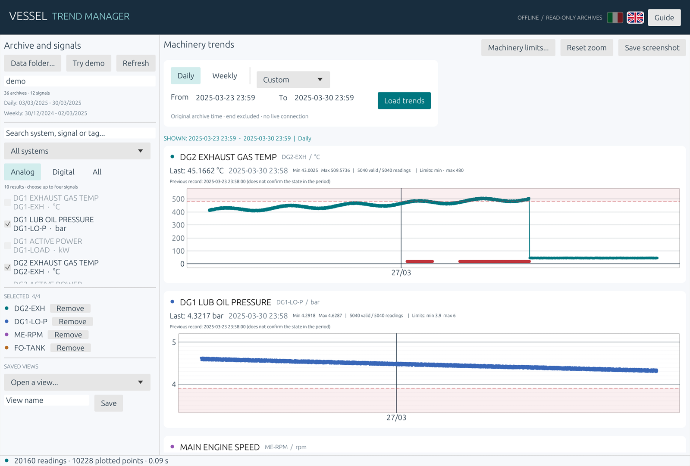
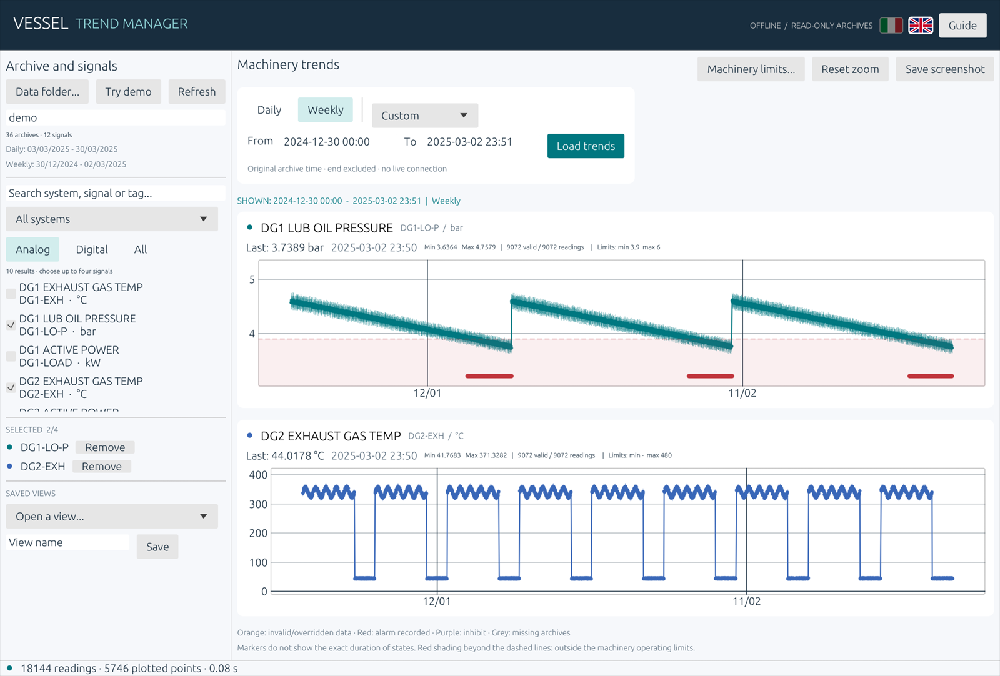
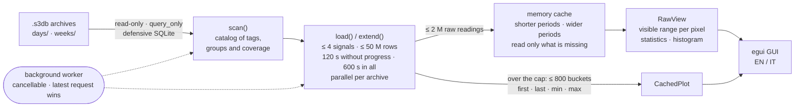

<p align="center">
  
</p>

<h1 align="center">Vessel Trend Manager</h1>

<p align="center">
  <b>Offline trend viewer for ship machinery archives.</b><br>
  Months of alarm-and-monitoring-system (AMS) history in a few clicks: one portable <code>.exe</code>, no install, no network, read-only.
</p>

<p align="center">
  
  
  
  
  
  
</p>

<p align="center">
  
</p>

> All screenshots use the built-in **synthetic demo**: a simulated voyage with a developing
> generator exhaust fault, a clogging lube-oil filter, a sensor dropout and a missing archive,
> with synthetic machinery operating limits.

## Why

Machinery data on board usually sits in daily and weekly SQLite exports that nobody
opens: the AMS console shows hours, not months. Vessel Trend Manager turns those
exports into searchable, zoomable trends on a separate PC, so slow drifts and trends become
visible before they become alarms.

## Features

| | |
|---|---|
| **Every raw reading** | Daily loads keep up to 2 million raw readings in memory; zoom and pan draw the visible range from them, every reading when it fits, otherwise the real first, last, min and max per pixel column. Larger loads fall back to ≤ 800 buckets with the same rule, with a visible warning. |
| **Fast on large histories** | Background, cancellable, parallel reads. A shorter period of loaded signals comes from memory; a wider one reads only the archives that memory lacks. |
| **Light analysis** | For the visible range: count, valid share, min, max, mean and σ; digital state changes (counts, no durations); histogram; right-click measure of Δt, Δ and rate per hour between two readings; Isolation Forest marks for unusual readings; Jev-style pattern classifier; CSV export of the raw readings for Excel. |
| **Honest plots** | Invalid, overridden, alarm and inhibit flags are marked; gaps and missing archives are shaded, never interpolated. |
| **Machinery operating limits** | Min/max limits from a CSV file editable in Excel; the zone beyond each limit is shaded, with no rescaling for far limits. |
| **Daily and weekly sources kept apart** | Raw readings and weekly min/max aggregates (drawn as range bars) are never mixed. |
| **Built for operators** | Search by system, signal or tag; up to four signals; saved views; PNG screenshots; English/Italian switch. |
| **Safe by design** | Archives opened read-only with SQLite in defensive mode; no network code; DLLs loaded only from System32. |
| **Portable** | One statically linked `.exe` (~5 MB zipped); no runtime, database server or browser needed. |

## Try it in 30 seconds

1. Download `VesselTrendManager_Rust_Windows_x64.zip` from
   [Releases](https://github.com/danieleb1861/vessel-trend-manager/releases) and extract it.
2. Run `VesselTrendManager.exe`.
3. Press **Try demo**: synthetic archives are generated in your temp folder and four
   signals open on the last seven days.

From source:

```powershell
cargo run --release -- --demo
```

<p align="center">
  
</p>

## Machinery operating limits

Press **Machinery limits…** and choose a CSV file with one row per signal:

```text
tag;min;max;unit;notes
DG2-EXH;;480;°C;exhaust gas temperature
DG1-LO-P;3.9;6;bar;lube oil pressure
```

- `tag` is the exact signal name in the archive; rows without a tag are ignored, `#` starts a comment.
- `min` or `max` may be empty; decimals with point or comma. If `unit` is filled it must match
  the archive unit, including case (`mW` differs from `MW`), otherwise the limits of that signal
  are not drawn and a message shows both units. Spellings that cannot be confused are accepted
  in any case: `kW`, `kWh`, `kVA`, `kvar`, `kV`, `kA`, `kPa`, `Hz`, `rpm`, `bar`, `°C`.
- The file opens and saves directly in Excel (UTF-8 or Windows CSV). Saved edits appear in the
  charts within seconds, without reloading. An unreadable update clears the displayed limits
  and reports an error; limits without units carry a verification warning.
- Limits close to the readings are brought into view; far limits do not rescale the chart and
  appear when zooming out. The demo ships with `SYNTHETIC_DEMO_LIMITS.csv`.

Limits are user-entered values, not AMS alarm thresholds. Keep real limit files local: like
archives and preferences, they are never part of the repository or the release package.
Synthetic limits load automatically only after explicitly opening the demo. Screenshots
and CSV exports require a new filename and never overwrite an existing file; CSV exports
are refused inside the archive folder.

## Analysis of the visible range

With raw daily data, a line under each chart summarises the readings currently shown and
follows zoom and pan:

- **Statistics**: readings, valid readings, min, max, mean and standard deviation (valid readings only).
- **State changes** (digital signals): rises and falls between consecutive valid readings;
  an invalid reading breaks the chain. Counts only: no running hours are inferred.
- **Histogram**: distribution of the valid readings shown, in 24 equal bins.
- **Measure**: right-click a reading (A) and a second one (B) to read Δt, Δ value and change
  per hour. Points snap to recorded readings; nothing is interpolated.
- **Unusual** (analog signals): an Isolation Forest (Liu, Ting and Zhou, 2008) on value and
  change per hour, trained in the app on the signal's loaded readings (at most 20,000, fixed
  seed), circles the most unusual 0.5% among the readings drawn. Exploratory, not an alarm:
  it knows no limits and learns from whatever was loaded, faults included.
- **Pattern** (analog signals): a Jev-style classifier answers "how does this signal behave over
  the shown range?" with fixed labels and probabilities: stable, drift, step, spikes, stuck. It is
  a small multinomial logistic regression on nine scale-free features (Theil–Sen trend, linearity,
  best two-segment split, robust spikes, flatness, roughness, …), trained in the app on synthetic
  windows only, in milliseconds. Exploratory, not calibrated on real vessels, not an alarm.
- **Export CSV**: the raw readings shown, with time to the nanosecond, value, unit, validity,
  alarm and inhibit flags, archive file and row; `;` separated, decimal comma in Italian,
  UTF-8 for Excel. Archive text is written so Excel never reads it as a formula.

## Use your own archives

Press **Data folder…** and choose the export folder, or pass `--data-dir`:

```text
EXPORT/
├── days/   Day_YYYY-MM-DD.s3db                      daily readings
└── weeks/  Week_from_YYYY-MM-DD_to_YYYY-MM-DD.s3db  weekly min/max aggregates
```

The reader expects these SQLite tables:

| Table | Used columns |
|---|---|
| `TagConfig` | `Id`, `Name`, `Description`, `EngUnit`, `TagType`, `AlarmGroup` |
| `TagType` | `Id`, `Name` (`Analog` / `Digital`) |
| `AlarmGroup` | `AlarmGroupNumber`, `AlarmGroupText` |
| `TagConfigDynamic` | `Id`, `TagConfig` |
| `TagValue` | `Id`, `Timestamp`, `Value`, `IsInvalid`, `IsOverride`, `IsInAlarm`, `IsInhibit`, `TagConfigDynamic`; weekly also `Min`, `Max`, `IntervalMarker` |

`--demo --data-dir <empty folder>` writes a complete example of this format.
Other layouts need an adapter in `src/archive.rs` (see [MAINTAINING.md](MAINTAINING.md)).

## How it works



SQLite never runs in the GUI loop. Every request is bounded in signals, rows and time
(it stops after 120 s without progress or 600 s in all), and a newer request cancels the
older one. The memory cache is dropped when the archive folder is closed or reopened.

The viewer is an aid for historical analysis, not a live alarm or certified safety system.
Use closed exports on a local disk; network shares can cause Windows network traffic even
though the application has no network client. Read-only access does not authenticate an export.
SQLite has a shared 64 MiB heap cap; catalogs, text fields and pending archive results are
also bounded. Unusual or malformed exports may be refused instead of plotted.

## Command line

```text
VesselTrendManager.exe [--data-dir DIR] [--demo] [--source daily|weekly]
                       [--days N | --all | --start "YYYY-MM-DD HH:MM" --end "..."]
                       [--tags A,B] [--check | --smoke-test] [--screenshot FILE.png]
```

`--check` runs the retrieval headless and prints a JSON summary. `--smoke-test` opens a
hidden window and exits with code 0 on success.

## Build

Rust 1.88+ and Visual Studio Build Tools (C++ and Windows SDK):

```powershell
cargo fetch --locked
cargo test --locked --offline
.\build.ps1        # fmt, clippy, tests, release build, zips and SHA256 in dist/
```

`dist` keeps only the latest release: the previous one is replaced after a
successful build, and any other file in `dist` stops the build without deleting anything.

| File | Responsibility |
|---|---|
| `src/main.rs` | Startup, CLI, UI language |
| `src/gui.rs` | GUI, plotting, saved views, machinery limits, analysis of the visible range |
| `src/archive.rs` | Read-only reader, raw readings and reduction, memory reuse, background worker |
| `src/demo.rs` | Deterministic synthetic archives and limits |
| `src/tests.rs` | Regression tests on synthetic data |

## Contributing

Issues and pull requests are welcome: see [CONTRIBUTING.md](CONTRIBUTING.md), and
[AGENTS.md](AGENTS.md) for AI coding agents. **Never attach real archives or screenshots
of real vessel data**; reproduce problems with `--demo` instead.

## License

[MIT](LICENSE) © danieleb1861. Third-party licenses are shipped in the release package.
Not affiliated with any ship automation vendor; all product names belong to their owners.
